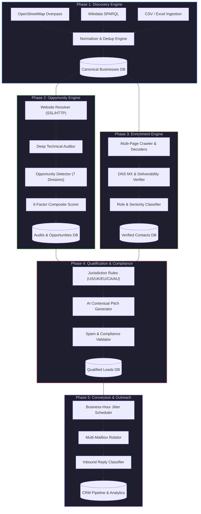
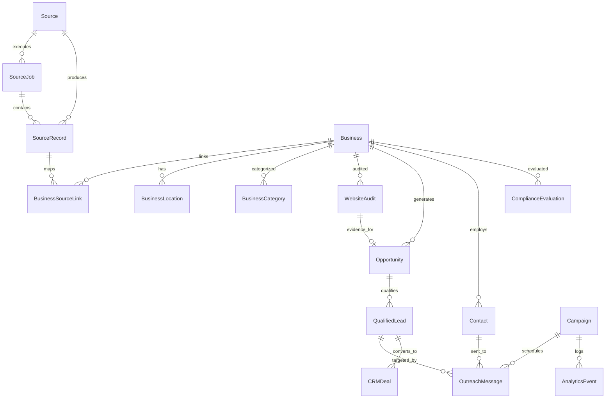

# SiteBlitz Lead Intelligence OS ⚡

> **Internal Autonomous Sales Intelligence, Website Auditor & Customer Acquisition Operating System for Digital Agencies**

[](https://fastapi.tiangolo.com)
[](https://python.org)
[](https://react.dev)
[](https://vitejs.dev)
[](https://www.sqlalchemy.org/)
[](https://www.postgresql.org/)
[]()
[]()

---

## 📖 Executive Summary

**SiteBlitz Lead Intelligence OS** is a 5-phase automated sales intelligence and customer acquisition engine engineered specifically for web development, mobile app, and digital marketing agencies.

Instead of paying for generic, stale B2B lists, SiteBlitz autonomously:
1. **Discovers** real operating businesses across any target geography or industry using public spatial, open-data, and registry adapters.
2. **Deep-Audits** their digital footprint — fingerprinting CMS platforms, responsive viewports, Core Web Vitals, SEO structure, Schema.org entities, security headers, accessibility blockers, e-commerce checkouts, and booking systems.
3. **Detects & Scores Opportunities** across 7 concrete agency service divisions, evaluating deal value ranges and ROI pitch angles.
4. **Enriches Verified Decision-Makers** — parsing team pages, decoding Cloudflare email protection, validating DNS MX records, detecting disposable domains, and classifying executive seniority.
5. **Enforces Multi-National Compliance** (GDPR, CAN-SPAM, CASL, Australia Spam Act) before orchestrating **throttled, deliverability-safe cold outreach** with CRM pipeline deal tracking.

---

## 🏗️ 5-Phase Architecture Blueprint



---

## ⚡ Core Engine Breakdown

### 📍 Phase 1: Discovery Engine
* **Pluggable Adapter Architecture**: Subclasses `BaseSourceAdapter` with strict rate-limiting, error isolation, and provenance tracking.
* **OpenStreetMap Adapter**: Overpass QL spatial queries supporting both coordinate radius search (`around:5000`) and city/country bounding boxes across 5 amenity groups.
* **Wikidata SPARQL Adapter**: High-level corporate entity queries filtering by ISO country codes and company instance types (`wd:Q4830453`).
* **CSV/XLSX Bulk Importer**: Header auto-detection and field mapping with BOM tolerance.
* **Intelligent Normalizer**: NFKD Unicode normalization, legal suffix stripping (LLC, Ltd, GmbH, Inc), international phone parsing, and fuzzy duplicate detection using Haversine coordinate distance and token similarity.

### 🔍 Phase 2: Opportunity Engine
* **Website Resolver**: Probes endpoints, follows redirect chains, validates TLS certificates, handles HTTP fallbacks to detect missing SSL, and identifies parked / under-construction pages.
* **Deep Technical Auditor**:
  * **15+ CMS Platforms**: WordPress (+Elementor), Shopify, Wix (Thunderbolt), Squarespace, Webflow, Joomla, Drupal, Ghost, HubSpot CMS, PrestaShop, Magento, BigCommerce, Weebly, Duda, GoDaddy.
  * **Frontend Frameworks**: React, Next.js, Vue, Nuxt.js, Angular, Svelte, TailwindCSS, Bootstrap, jQuery, Alpine.js, HTMX, Astro.
  * **Booking Widgets**: Calendly, Acuity, Booksy, OpenTable, Resy, Setmore, Fresha, Appointlet, TidyCal, SimplyBook, Bookeo, Treatwell, Vagaro, Mindbody, Booker.
  * **E-Commerce Systems**: Shopify, WooCommerce, BigCommerce, Magento, PrestaShop, Ecwid, Stripe Checkout, PayPal, Square Online, Snipcart.
  * **Analytics & Tracking**: Google Analytics 4, Universal Analytics, GTM, Meta Pixel, LinkedIn Insight Tag, TikTok Pixel, Hotjar, Microsoft Clarity, Segment, Plausible.
  * **Accessibility & SEO**: WCAG checks (missing `alt`, missing `<html> lang`, unlabeled inputs), Schema.org JSON-LD extraction, H1 heading structure, and meta tags.
  * **Security Headers**: HSTS, CSP, X-Frame-Options, X-Content-Type-Options, Referrer-Policy, and mixed-content detection.
* **Opportunity Detector (7 Service Divisions)**:
  * `NEW_WEBSITE`: Businesses operating without a website or on social media only (\$3k–\$12k).
  * `WEBSITE_REDESIGN`: Non-responsive mobile viewport, missing SSL, slow load time, legacy CMS (\$3.5k–\$15k).
  * `MOBILE_APP`: High-touch industries (dining, clinics, fitness, salons, delivery) (\$15k–\$50k).
  * `ONLINE_BOOKING`: Appointment-driven businesses lacking scheduling widgets (\$2.5k–\$8k).
  * `ECOMMERCE_EXPANSION`: Retail/catalog businesses with no online checkout (\$5k–\$25k).
  * `SEO_PERFORMANCE`: Critical meta tag, heading, or Schema.org deficiencies (\$1.8k–\$6k).
  * `CUSTOM_WEB_APP`: Multi-location franchises, logistics, portals, and complex workflows (\$12k–\$45k).
* **6-Factor Prioritization Scorer**: Combines Need Severity (40%), Service Fit (25%), Market Tier Budget (20%), and Contactability (15%) with regional purchasing power multipliers (US 1.3x, UK 1.2x, CH 1.4x, etc.) to produce a 0–100 score, priority (`CRITICAL`, `HIGH`, `MEDIUM`, `LOW`), deal valuation, and ROI summary.
* **On-Demand URL Auditing**: Standalone `/audit-url` endpoint audits any live URL without requiring a prior database record.

### 👤 Phase 3: Contact & Enrichment Engine
* **Multi-Page Crawler**: Crawls high-probability contact pages (`/contact`, `/about`, `/team`, `/leadership`, `/staff`, `/management`).
* **De-obfuscation & Decoders**:
  * Cloudflare XOR cipher de-obfuscation (`data-cfemail`).
  * Text obfuscation decoding (`name [at] company [dot] com`).
  * Schema.org `Person` and `ContactPoint` JSON-LD extraction.
* **DNS MX Deliverability Verifier**:
  * Resolves live MX records with RFC 5321 A-record fallback.
  * Identifies mail host providers (Google Workspace, Microsoft 365, Cloudflare, ProtonMail, Zoho).
  * Flags disposable / temporary email domains (100+ domain blacklist).
  * Distinguishes corporate addresses from free webmail (Gmail, Yahoo, Hotmail).
  * Suggests typo corrections (e.g., `gmial.com` $\to$ `gmail.com`).
* **Role & Seniority Classifier**:
  * Strips international honorifics (`Dr.`, `Prof.`, `Eng.`, `Herr`, `Frau`, `Monsieur`).
  * Preserves compound surnames (*Van Der Bellen*, *De La Cruz*).
  * Classifies hierarchy: `EXECUTIVE`, `MANAGEMENT`, `TECHNICAL`, `MARKETING`, `STAFF`, `GENERAL_INBOX`.
* **Phone Formatter**: Cleans and validates phone numbers into international E.164 formats, identifying toll-free lines.

### ⚖️ Phase 4: Qualification & Compliance Engine
* **International Jurisdiction Profiles**:
  * **United States (CAN-SPAM)**: Validates opt-out mechanisms, physical postal address, non-deceptive subject lines.
  * **United Kingdom (GDPR / PECR)**: Corporate subscriber exemption evaluation, legitimate interest assessment (LIA), unsubscribe mandate.
  * **European Union (EU GDPR)**: Strict B2B rules, automatic manual-review routing for strict jurisdictions (Germany UWG, Austria, Greece).
  * **Canada (CASL)**: Conspicuously published B2B contact evaluation without statement of non-solicitation.
  * **Australia (Spam Act 2003)**: Directly relevant published business address verification.
* **AI Contextual Personalizer**: Generates highly targeted, value-first email copy referencing detected technical audit flaws, business name, and specific pitch angles.
* **Output & Spam Validator**: Screens copy against spam trigger phrases, validates unsubscribe links, checks physical address tokens, and ensures zero unrendered template variables.
* **Suppression & Opt-Out Registry**: Centralized exclusion list blocking domains, exact emails, and tracking cool-down periods.

### 📬 Phase 5: Conversion & Outreach Engine
* **Campaign Scheduler**:
  * Enforces business-hour delivery windows (9:00 AM – 5:00 PM recipient local time).
  * Filters out weekends.
  * Injects organic jitter delays (60–300 seconds) between dispatches to mimic human sending patterns.
  * Strictly enforces daily sending limits per mailbox to prevent burn.
* **Sender Mailbox Rotator**: Round-robin dispatch across multiple sending mailboxes with dynamic token replacement.
* **Inbound Reply Intent Classifier**:
  * Classifies incoming responses into `INTERESTED`, `NOT_INTERESTED`, `UNSUBSCRIBE_REQUEST`, `OUT_OF_OFFICE`, `GENERAL_INQUIRY`.
  * Auto-adds unsubscribe requests to the suppression database.
* **CRM Sales Pipeline**: Tracks deals through pipeline stages: `PROSPECT` $\to$ `CONTACTED` $\to$ `MEETING_SCHEDULED` $\to$ `PROPOSAL_SENT` $\to$ `NEGOTIATION` $\to$ `WON` / `LOST`.
* **Funnel Analytics**: Audit log recording sends, opens, clicks, replies, and conversions.

---

## 💻 Tech Stack & Architecture

| Layer | Technologies & Tools |
| :--- | :--- |
| **Backend Framework** | **FastAPI 0.115+** (Asynchronous Python 3.11+) |
| **ORM & Database Layer** | **SQLAlchemy 2.0 (Async)** with asyncpg & aiosqlite |
| **Database Engines** | **PostgreSQL 16** (Production/Docker) & **SQLite** (Zero-config local dev) |
| **Migrations** | **Alembic 1.14+** (Phased migrations 001, 002, 003) |
| **Task Queue & Caching** | **Redis 7** + **RQ** (Redis Queue) |
| **Network & Scraping** | **httpx 0.27+**, **BeautifulSoup4**, **lxml**, **dnspython** |
| **Data Validation & Settings** | **Pydantic v2** + **pydantic-settings** |
| **Logging & Retries** | **structlog** (structured JSON/console logs), **tenacity** |
| **Frontend Framework** | **React 18** + **Vite 6** + **React DOM** |
| **Testing Suite** | **pytest 8+**, **pytest-asyncio**, **pytest-cov**, **Faker** |

---

## 🗄️ Database Entity-Relationship Diagram



---

## 📁 Repository Structure

```
Siteblitz_LeadGenerator/
├── backend/
│   ├── alembic/
│   │   ├── versions/
│   │   │   ├── 001_phase1_discovery.py      # Core business & source tables
│   │   │   ├── 002_phase2_opportunity.py    # Website audits & opportunities
│   │   │   └── 003_phase3_enrichment.py     # Contacts & verification tables
│   │   └── env.py
│   ├── app/
│   │   ├── api/
│   │   │   ├── router.py                    # Aggregated v1 API router
│   │   │   └── v1/
│   │   │       ├── businesses.py            # Business CRUD & search
│   │   │       ├── campaigns.py             # Outbound campaigns & CRM deals
│   │   │       ├── contacts.py              # Verification & contact enrichment
│   │   │       ├── discovery.py             # Discovery runs & CSV imports
│   │   │       ├── opportunities.py         # Scored leads & on-demand audits
│   │   │       ├── qualification.py         # Compliance evaluation & pitches
│   │   │       └── sources.py               # Source adapters management
│   │   ├── engines/
│   │   │   ├── conversion/                  # Phase 5: Scheduler, Sender, Replies
│   │   │   ├── discovery/                   # Phase 1: OSM, Wikidata, CSV, Normalizer
│   │   │   ├── enrichment/                  # Phase 3: Discovery, Verifier, Classifier
│   │   │   ├── opportunity/                 # Phase 2: Resolver, Auditor, Detector, Scorer
│   │   │   └── qualification/               # Phase 4: CountryRules, Personalizer, Validator
│   │   ├── models/                          # SQLAlchemy ORM models (Phases 1-5)
│   │   ├── schemas/                         # Pydantic request/response models
│   │   ├── services/                        # Service orchestration layer
│   │   ├── config.py                        # Pydantic Settings configuration
│   │   ├── database.py                      # Async & Sync database engines
│   │   ├── main.py                          # FastAPI application factory
│   │   └── seed_data.py                     # Realistic multi-phase data seeder
│   └── tests/
│       ├── test_conversion/                 # Phase 5 unit tests
│       ├── test_discovery/                  # Phase 1 unit tests
│       ├── test_enrichment/                 # Phase 3 unit tests & deep features
│       ├── test_opportunity/                # Phase 2 unit tests & deep features
│       ├── test_qualification/              # Phase 4 unit tests
│       └── conftest.py
├── frontend/
│   ├── src/
│   │   ├── components/                      # Sidebar, Header, StatCards, Badges
│   │   ├── pages/                           # Dashboard, Opportunities, Contacts, etc.
│   │   ├── services/api.js                  # Frontend API client
│   │   ├── App.jsx
│   │   └── main.jsx
│   ├── package.json
│   └── vite.config.js
├── docker-compose.yml                       # PostgreSQL + Redis + API
├── Dockerfile
├── pyproject.toml                           # Python project configuration
└── .env.example                             # Environment configuration template
```

---

## 🚀 Quick Start Guide

### 1. Prerequisites
* **Python 3.11+** installed
* **Node.js 20+** and `npm` installed
* *(Optional)* Docker & Docker Compose for PostgreSQL 16 & Redis 7

---

### 2. Backend Setup

```bash
# Clone repository
cd Siteblitz_LeadGenerator

# Create & activate virtual environment
python -m venv venv
venv\Scripts\activate       # On Windows
# source venv/bin/activate  # On macOS/Linux

# Install backend dependencies
pip install -e ".[dev]"

# Configure environment (defaults to zero-config SQLite)
copy .env.example .env

# Populate database with rich sample data across all 5 phases
python -m backend.app.seed_data

# Start FastAPI server
python -m uvicorn backend.app.main:app --host 127.0.0.1 --port 8000 --reload
```

* Backend API: **http://127.0.0.1:8000**
* Interactive Swagger Docs: **http://127.0.0.1:8000/docs**
* ReDoc Documentation: **http://127.0.0.1:8000/redoc**
* Health Endpoint: **http://127.0.0.1:8000/health**

---

### 3. Frontend Setup

In a separate terminal:

```bash
cd frontend

# Install Node dependencies
npm install

# Start Vite development server
npm run dev
```

* Web Application: **http://localhost:5173** (automatically proxies `/api` and `/health` to the backend)

---

### 4. Running With Docker (PostgreSQL & Redis)

If you prefer full containerized infrastructure:

```bash
# Start PostgreSQL, Redis, and API backend
docker-compose up -d

# Run migrations
docker-compose exec api alembic upgrade head

# Seed initial data
docker-compose exec api python -m backend.app.seed_data
```

---

## 📡 REST API Reference (v1)

### Business & Discovery
| Method | Endpoint | Description |
| :--- | :--- | :--- |
| `GET` | `/api/v1/businesses` | List businesses with filtering by category, status, country, and pagination |
| `GET` | `/api/v1/businesses/{id}` | Get business profile, locations, categories, and audits |
| `PATCH`| `/api/v1/businesses/{id}` | Update business status or metadata |
| `POST`| `/api/v1/discovery/run` | Execute synchronous discovery run for a specific source adapter |
| `POST`| `/api/v1/discovery/import-csv` | Upload and ingest a CSV file containing business leads |
| `GET` | `/api/v1/discovery/jobs` | Monitor status of discovery jobs |

### Opportunities & Website Audits
| Method | Endpoint | Description |
| :--- | :--- | :--- |
| `GET` | `/api/v1/opportunities` | List scored opportunities filtered by service category, priority, and score |
| `GET` | `/api/v1/opportunities/{id}` | Get opportunity details, pitch angles, and evidence |
| `PATCH`| `/api/v1/opportunities/{id}` | Update opportunity status (`IDENTIFIED`, `QUALIFIED`, `CONVERTED`) |
| `POST`| `/api/v1/opportunities/evaluate-business/{id}` | Trigger live resolution, audit, detection, and scoring for a business |
| `POST`| `/api/v1/opportunities/batch-evaluate` | Batch evaluate businesses lacking audits |
| `POST`| `/api/v1/opportunities/audit-url` | **On-demand URL audit** — immediate audit, tech fingerprint, & pitch generation |
| `GET` | `/api/v1/opportunities/audits/{business_id}` | Retrieve historical technical audit logs |
| `GET` | `/api/v1/opportunities/stats/overview` | Aggregated opportunity counts and score distribution |

### Contacts & Verification
| Method | Endpoint | Description |
| :--- | :--- | :--- |
| `GET` | `/api/v1/contacts` | List contacts with filters by role level, email status, and min verification score |
| `POST`| `/api/v1/contacts` | Manually register a contact with auto-verification and role classification |
| `POST`| `/api/v1/contacts/enrich-business/{id}` | Trigger multi-page contact crawling & verification for a business |
| `POST`| `/api/v1/contacts/batch-enrich` | Batch enrich businesses having 0 contacts |
| `POST`| `/api/v1/contacts/verify-email` | **Standalone email verifier** (MX lookup, mail provider detection, typo fix) |
| `POST`| `/api/v1/contacts/verify-phone` | **Standalone phone verifier** (normalization, E.164 format, toll-free check) |
| `POST`| `/api/v1/contacts/find-domain-contacts` | **On-demand domain discovery** without pre-existing database record |
| `GET` | `/api/v1/contacts/stats/overview` | Enriched contact count, verified deliverability rate, and role breakdown |

### Qualification & Outbound Campaigns
| Method | Endpoint | Description |
| :--- | :--- | :--- |
| `GET` | `/api/v1/qualification/leads` | List qualified leads ready for sales outreach |
| `POST`| `/api/v1/qualification/evaluate/{opportunity_id}` | Run multi-jurisdictional compliance evaluation and generate pitch copy |
| `GET` | `/api/v1/campaigns` | List outreach campaigns |
| `POST`| `/api/v1/campaigns` | Create an outbound email campaign with daily rate limits and schedule window |
| `POST`| `/api/v1/campaigns/{id}/start` | Launch campaign queue processor |
| `GET` | `/api/v1/campaigns/deals` | CRM sales pipeline deals by stage (`PROSPECT` $\to$ `WON`) |
| `POST`| `/api/v1/lead-radar/evaluate` | Run 6-fact, 51-condition, 17-recipe pitch & ranking evaluation |
| `POST`| `/api/v1/lead-radar/mumbai-funnel` | Execute 8-stage pipeline reduction from raw places to verified shortlist |
| `POST`| `/api/v1/lead-radar/absence-certificate` | 3-path absence audit & SHA-256 cryptographic certificate generation |
| `POST`| `/api/v1/lead-radar/revenue-estimate` | Calibrated category revenue formula & review-velocity bounds |
| `GET` | `/api/v1/lead-radar/regions/baselines` | 45 global city baseline metrics from Overture Places |
| `GET` | `/api/v1/lead-radar/regions/profiles` | Regional priority profiles for 16 Indian states & 27 countries |

---

## 📡 Lead-Radar Condition Strategy Core (2026-11-06)

Engineered directly from the multi-round strategy framework for granular digital need identification:

### 1. The 8-Stage Funnel (Mumbai 2-Lakh Pipeline Model)
```
Stage 0: All Places (195,898)
  └── Stage 1: Confident it Exists (confidence >= 0.7) -> 64,426
        └── Stage 2: No Website on File -> 15,862
              └── Stage 3: Reachable Contacts (Phone 10.5k, Email 5.2k, Social 14.8k)
                    └── Stage 4: Verified Commercial Entity (G1-G4 Gates passed)
                          └── Stage 5: Truly Absent (3-Path Absence Search W1 verified)
                                └── Stage 6: Alive & Active (G7, D3, D4 in 90 days)
                                      └── Stage 7: Real Customer Task Gap (W2-W13 unserved)
                                            └── Stage 8: Strategic Segmentation (A, Warm, B, C)
```

### 2. Six Separate Facts Stored per Business Entity
* **Owned Presence**: `OWN_DOMAIN` | `BUILDER_SUBDOMAIN` | `PARENT_COMPANY_PAGE` | `SOCIAL_ONLY` | `MARKETPLACE_ONLY` | `LINK_IN_BIO` | `NONE_FOUND` | `UNRESOLVED`
* **Availability**: `WORKING` | `PARKED` | `COMING_SOON` | `DNS_FAIL` | `CERTIFICATE_FAIL` | `REPEATED_SERVER_FAIL` | `REDIRECTED` | `UNKNOWN`
* **Customer Task Covered**: `INFORMATION` | `PRODUCT_EVALUATION` | `ENQUIRY` | `BOOKING` | `ORDERING` | `LOCATION` | `NONE_NEEDED` | `UNKNOWN`
* **Task Quality**: `WORKS` | `INCOMPLETE` | `FAILS_REPRODUCIBLY` | `NOT_TESTED`
* **Buying Status**: `EXPLICITLY_SEEKING` | `EXPLICITLY_NOT_SEEKING` | `SUPPLIER_ALREADY_CHOSEN` | `UNKNOWN`
* **Authority**: `LOCAL_OWNER` | `FRANCHISEE` | `PARENT_COMPANY` | `PROCUREMENT_TEAM` | `UNRESOLVED`

### 3. The 51 Condition Library
* **Gates (G1–G7)**: Entity verification, source licensing, duplicate merging, non-procuring exclusion, closure confirmation, centralized authority gate, active operations.
* **Website & Tasks (W1–W16)**: Absence verification, unhosted task, repeated failure, SSL warnings, broken actions, mobile viewport failure, missing pricing/hours, conflicting listings, parent omission, language gaps, CrUX poor speed, dead ad links, WCAG accessibility barriers, audience access limits, local format errors, third-party app exclusion.
* **Intent Signals (I1–I8)**: Public RFPs <30d, official website tenders, vendor evaluations, supplier replacement requests, coming soon pages, newly parked domains <90d, digital job hiring, incomplete builder sites.
* **Demand Signals (D1–D12)**: Active ad spend into gaps, unanswered repeat queries, review velocity, promotional announcements, direct sales intent, multi-location confusion, address moves, tender prequalifications, export manifests, peer task adoption, DM messaging bottlenecks, commission aggregator dependence.
* **Stop Conditions (C1–C6)**: Authorized refusal, existing solution complete, incumbent agency appointed, platform sufficient, explicitly deferred, platform-only sufficient without friction.
* **Jurisdiction (J1–J2)**: Statutory digital disclosures, regional technical deliverability.

### 4. 17 Combination Sales Recipes (R1 to R17)
Deterministic matching pairs concrete evidence to proven agency pitch copy:
* **R1 (Open Mandate)** $\to$ Segment A
* **R2 (Open Tender)** $\to$ Segment A
* **R3 (Supplier Replacement)** $\to$ Segment A
* **R4 (Founder's Case Corrected)**: Active + 2+ sources + Promoting + Truly no site + Task gap $\to$ Segment B
* **R5 (Social Attention, Unanswered Questions)** $\to$ Segment B
* **R6 (Ad Leads to Broken Page)** $\to$ Segment B
* **R7 (Live Business, Dead Site)** $\to$ Segment B
* **R8 (Booking Bottleneck)** $\to$ Segment B
* **R9 (Marketplace Wants Direct Channel)** $\to$ Segment B
* **R10 (Multi-Location Confused Journey)** $\to$ Segment B
* **R11 (Moved, Web Didn't Follow)** $\to$ Segment B
* **R12 (Export Buyers Cannot Evaluate)** $\to$ Segment B
* **R13 (Mobile Failure Under Demand)** $\to$ Segment B
* **R14 (Accessibility Blocked)** $\to$ Segment B
* **R15 (Self-Built Site Missing Task)** $\to$ Segment B
* **R16 (Launch Underway, Supplier Chosen)** $\to$ Segment C
* **R17 (Something in Motion)**: G7 active + Promoting + Domain/coming-soon notice $\to$ Warm Context

### 5. Pitch Rules
* **Strict Law**: The opening line is ALWAYS an observed fact. Commercial implications are strictly phrased as questions.
* **Never Say Warnings**: System hard-blocks cliché phrases ("You need a website", "We know you're looking", "Your ad spend is wasted", "Your agency is failing").

### 6. Calibrated Revenue Bounds & Confidence Ladder
Produces auditable 80% confidence interval ranges across 10 categories (Restaurant, Clinic, Salon, Hotel, Retail, Manufacturer/Exporter, Professional Services, Education, Gym, Real Estate Broker) and bounded review-propensity models ($0.5\% - 2.5\%$).

### 7. 45-City Baselines & Regional Calibrations
Built-in empirical baselines across 45 global cities and regional priority profiles ($Check\ First\ \uparrow$, $Trust\ Less\ \downarrow$) covering 16 Indian states and 27 nations. Sample blending applies $n / (n+200)$ weighting for statistical robustness.

---

## 🧪 Automated Test Suite

SiteBlitz includes an exhaustive, production-grade test suite covering unit, integration, and security checks across all 5 engines and the Lead-Radar Condition Core.

```bash
# Run all 190 tests
pytest backend/tests -v

# Run Lead-Radar Engine tests
pytest backend/tests/test_lead_radar -v

# Run Phase 2 Opportunity Engine tests
pytest backend/tests/test_opportunity -v

# Run Phase 3 Enrichment Engine tests
pytest backend/tests/test_enrichment -v
```

```
============================= test session starts =============================
platform win32 -- Python 3.14.3, pytest-9.2.0
collected 190 items

backend/tests/test_conversion/test_replies.py ....                       [  2%]
backend/tests/test_conversion/test_scheduler.py .......                  [  5%]
backend/tests/test_conversion/test_sender.py ...                         [  7%]
backend/tests/test_discovery/test_adapters.py ......................     [ 18%]
backend/tests/test_discovery/test_normalizer.py ........................ [ 31%]
backend/tests/test_discovery/test_wikidata.py .......                    [ 42%]
backend/tests/test_enrichment/test_classifier.py .....                   [ 44%]
backend/tests/test_enrichment/test_discovery.py ....                     [ 46%]
backend/tests/test_enrichment/test_phase3_deep.py .........              [ 51%]
backend/tests/test_enrichment/test_verifier.py .....                     [ 54%]
backend/tests/test_lead_radar/test_absence_and_regions.py ....           [ 56%]
backend/tests/test_lead_radar/test_api_endpoints.py ......               [ 59%]
backend/tests/test_lead_radar/test_conditions.py ........                [ 63%]
backend/tests/test_lead_radar/test_mumbai_pipeline_funnel.py .           [ 64%]
backend/tests/test_lead_radar/test_ranking.py ..                         [ 65%]
backend/tests/test_lead_radar/test_revenue.py ........                   [ 69%]
backend/tests/test_lead_radar/test_segmenter_and_recipes.py ......       [ 72%]
backend/tests/test_lead_radar/test_six_facts.py ..                       [ 73%]
backend/tests/test_opportunity/test_auditor.py .......                   [ 77%]
backend/tests/test_opportunity/test_detector.py ......                   [ 80%]
backend/tests/test_opportunity/test_phase2_deep.py ........              [ 84%]
backend/tests/test_opportunity/test_resolver.py ....                     [ 86%]
backend/tests/test_opportunity/test_scorer.py ...                        [ 88%]
backend/tests/test_qualification/test_ai_personalizer.py ....            [ 90%]
backend/tests/test_qualification/test_compliance_evaluator.py .......    [ 94%]
backend/tests/test_qualification/test_country_rules.py ......            [ 97%]
backend/tests/test_qualification/test_output_validator.py .....          [100%]

============================ 190 passed in 42.64s =============================
```

---

## 🔒 Security, Compliance & Ethical Standards

* **Data Provenance**: Every business and contact attribute is tagged with its original source URL and extraction method (`BusinessSourceLink`).
* **Zero Fabrication Guarantee**: Fields that cannot be determined with confidence remain `None` — the platform never invents data.
* **Strict Suppression List**: Automated opt-out and suppression management honors unsubscribes instantly across all campaigns.
* **Deliverability Safeguards**: Hard caps on daily sends, recipient business-hour window enforcement, and organic delay jitter prevent mailbox blacklisting.
* **Compliance Checks**: Built-in evaluation of US CAN-SPAM, UK GDPR/PECR, EU GDPR, Canada CASL, and Australia Spam Act ensures legal compliance before any message is sent.

---

## 📄 License

Internal proprietary software developed for SiteBlitz agency customer acquisition and sales automation. All rights reserved.
